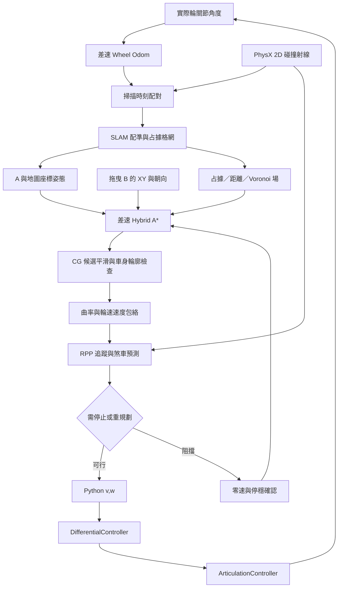

# 架構與演算法

世界位姿提供獨立診斷、停止監測與視覺顯示基準。導航 A 與 SLAM 控制姿態來自輪式 odom 和掃描。

## 全域規劃

amr_planner_core.py 使用連續 XY／yaw 姿態配離散分箱搜尋。差速運動基元可前進、倒退及原地旋轉。2.0 先搜尋無 spin 的路徑，在分配預算內失敗後轉入允許 spin 的搜尋。此結果不能證明連續路徑絕對不存在。

代價含路長、旋轉、換向、動作變化與 Voronoi 偏好。啟發式權重為 1.2，最短路與可採納性未獲保證。Voronoi 偏好不能取代完整矩形碰撞檢查。

## 平滑與速度

path_geometry.py 建立連續終點候選。trajectory_optimization.py 對同方向行駛段做數值 CG，再驗證曲率及密集車身輪廓取樣。細階段不合格時可採粗階段或原路。軟代價改善與 CG 收斂為不同判準。

speed_profile.py 用曲率、最大角速度、候選側向加速度及輪速限制產生速度包絡，再作加速及煞車掃描。tracking_safety.py 預測反應時間與煞車段。預設減速度為工程假設，實際車身滑移與煞車能力要由模擬驗證。

## RPP 與局部避障

rpp_core.py 追蹤參考路徑、管理前視點與轉向、接近終點降速、檢查局部障礙。它在這個架構中是局部追蹤控制器。碰撞拒絕時經停穩交接啟動全域重規劃。

## SLAM

slam_core.py 由輪角構成 WheelOdom，依掃描時戳插值，掃描匹配及圖優化更新估計。occupancy.py 保存未知／自由／占據格網。即時新鮮度、配準接受與正式地圖保存分開記錄。

## 論文對照

- Dolgov 等，2008，Practical Search Techniques in Path Planning for Autonomous Driving。採用連續姿態搜尋、Voronoi 場與 CG 平滑思路。
- Meng 等，2023，Improved Hybrid A-Star Algorithm for Path Planning in Autonomous Parking System Based on Multi-stage Dynamic Optimization。採四角最大 Voronoi 代價思路。DOI 10.1007/s12239-023-0038-1。
- 本版用差速運動基元、數值梯度和檢查式插值。汽車 Reeds–Shepp、雙啟發式查表及多階段中間目標策略尚未完整重現。

廠商與論文原始 PDF 在外部資料夾保存。本倉庫保留方法對照及程式。
